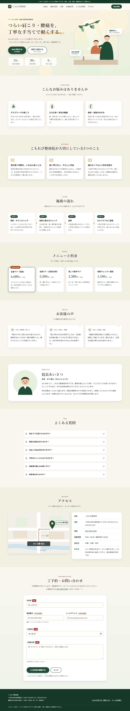

# こもれび整体院（デモLP）

**公開ページ: https://deskloom.github.io/demo-lp-local-business/**
**制作メモ（導線・計測・AIO・品質の数字）: https://deskloom.github.io/demo-lp-local-business/case.html**
**計測の動きを見る: https://deskloom.github.io/demo-lp-local-business/?track=1**（右下に記録されたイベントが出ます）

架空の地域ビジネス「こもれび整体院」の1ページLPです。
「店舗・医院のホームページ／LPを作ってほしい」という依頼に対して、こういう品質で作れますと見せるためのポートフォリオ用デモです。

**素のHTML/CSS/JavaScriptだけ**で作っています。ビルド工程・フレームワーク・外部CDN・外部フォント・外部画像は使っていません（イラストはすべてインラインSVG）。
**店名・人名・住所・電話番号・メールアドレス・お客様の声はすべて架空**です（電話は `000-0000-0000`、メールは `example.com`）。

## スクリーンショット

撮影条件：Chrome headless（puppeteer-core）・DPR 1・フルページ。実寸は 375x10808 / 768x8268 / 1280x6931 px（PNGヘッダを読んで確認）。

### 1280px（PC）


### 768px（タブレット）


### 375px（スマホ）


## ページの構成

1. ファーストビュー（キャッチコピー・Web予約／電話の2つの導線・信頼の数字3つ・イラスト）
2. CONCERN … こんなお悩みはありませんか（3つ）
3. REASON … 大切にしている3つのこと
4. FLOW … 施術の流れ（4ステップ）
5. MENU … メニューと料金（4つ・初回におすすめ表示）
6. VOICE … お客様の声（3件・架空と明記）
7. PROFILE … 院長あいさつ
8. FAQ … よくある質問（6問）
9. ACCESS … 地図イラスト・店舗情報
10. RESERVATION … 予約フォーム（入力チェック → 確認画面 → 送信）

## 作り込んだところ

- **問い合わせへの導線**：ヘッダー・ファーストビュー・フォームの3か所に予約ボタン。スマホでは画面下に「Web予約／電話する」を固定表示し、予約フォームが画面に入ったら自動で隠す。
- **フォーム**：電話かメールのどちらか必須・希望日は今日以降・相談内容10文字以上を、各欄の下にエラー表示。確認画面のあとに入力が変わったら確認を取り消す。`config.js` の `FORM_ENDPOINT` に送信先URLを入れると `fetch` でPOSTする（空のときは送信しないデモモード）。
- **AI検索・SEO**：
  - JSON-LD 2種（`HealthAndBeautyBusiness`＋料金の `Offer`、`FAQPage`）。FAQPage の質問はページに表示しているFAQと完全に一致させ、テストで確かめている
  - `llms.txt`（店の概要・料金・営業時間・FAQをAI向けにMarkdownで要約）、`robots.txt`、`sitemap.xml`
  - canonical、OGP（`og.png` 1200x630・`summary_large_image`）、theme-color、SVGのfavicon
- **計測（GA4 / GTM）**：予約・電話ボタンのクリック（どの位置か・Webか電話か）、各セクションの閲覧（0.8秒以上留まったもの）、フォームの入力開始・入力ミスの欄・確認・送信完了を `dataLayer` に積む。GTMを入れればそのままGA4のイベントになる。入力値は送らない。`?track=1` を付けると画面右下にイベントを表示する。
- **演出**：スクロールでカードがふわっと表示される（IntersectionObserver）。`prefers-reduced-motion: reduce` のときはすべての動きを止める。JavaScriptが無効でも内容はすべて表示される。
- **アクセシビリティ**：見出しは h1 が1つで順番どおり。意味のあるイラストに `role="img"`＋`aria-label`、飾りは `aria-hidden`。キーボード操作で見えるフォーカス枠。本文の文字色はコントラスト比4.5:1以上の色を使用。

## フォルダ構成

```text
.
├── index.html            # LP本体（全10セクション・JSON-LD 2種）
├── case.html             # 制作メモ（このLPの作り方）
├── config.js             # 送信先設定（FORM_ENDPOINT。空＝デモモード）
├── css/style.css         # スタイル（レスポンシブ・外部フォントなし）
├── js/
│   ├── validate.js       # DOM非依存の入力チェック（ブラウザとNodeで共用）
│   ├── main.js           # フォーム表示制御（確認画面・送信・エラー表示）
│   ├── ui.js             # 演出と計測（スクロール表示・スマホ固定ボタン・cta_click / section_view）
│   ├── validate.test.js  # 入力チェックのテスト（32件）
│   ├── main.test.js      # 送信完了メッセージと計測イベントのテスト（6件）
│   └── page.test.js      # ページ品質のテスト（7件）
├── llms.txt / robots.txt / sitemap.xml
├── og.png                # OGP画像（1200x630。docs/og.html を撮影して作成）
├── docs/
│   ├── og.html           # OGP画像の元
│   └── screenshots/      # 375 / 768 / 1280px
└── package.json / .htmlvalidate.json / LICENSE
```

## 動かし方

ビルドは不要です。`index.html` をブラウザで直接開くだけで動きます（ESモジュールを使わず classic script のみ）。

```sh
npm install                   # html-validate を使う場合のみ
npm test                      # 計45件
npx html-validate index.html case.html  # HTML検証
```

## テストと確認の結果（2026-10-15）

- `npm test`：**45件すべて通過**（入力チェック32件＋送信と計測イベント6件＋ページ品質7件）。計測のテストでは、イベントの順番と、入力値（名前・連絡先・相談内容）が dataLayer に入らないことを確かめる。制作メモに書いたイベント一覧と実装のイベント名が一致することもテストする。
  ページ品質のテストは、表示テキストに開発者向けの文言（`FORM_ENDPOINT` など）が無いこと、「デモ」の表記が3回以下に集約されていること、JSON-LD が読めて FAQPage と表示FAQが一致すること、`robots.txt`・`sitemap.xml`・`llms.txt`・`og.png`（1200x630）があること、canonical・og:image・description があること、「施術の流れ」「お客様の声」があることを確かめる。手直し前のページでは6件中4件が失敗することを確認した。
- `npx html-validate index.html`：**エラー0**。
- 実ブラウザ（Chrome headless）：375 / 768 / 1280px で `scrollWidth` が画面幅と一致（横スクロールなし）、コンソールエラーなし。空送信 → エラー表示、正しく入力 → 確認画面 → デモモードの完了表示。予約フォームが見えるとスマホの固定ボタンが隠れる。撮った画像を目視し、はみ出し・重なりがないことを確認。

## できていないこと

- 送信先が未設定のため、実際の予約受付はできない（実サーバー相手の送受信は**未確認**）。
- 地図はイラストで、Googleマップ等の埋め込みではない。
- SNSでのOGPプレビューの表示、実機（iPhone / Android）での表示は**未確認**（Chromeのデバイスエミュレーションのみ）。

## ライセンス

MIT（著作者: `deskloom`）。詳しくは [LICENSE](LICENSE) を参照。
